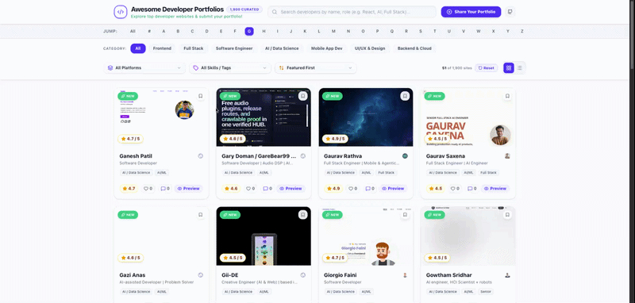

# 🚀 Awesome Developer Portfolios

<p align="center">
  <a href="https://balavenkatesh3322.github.io/awesome-developer-porfolio/">
    
  </a>
</p>

<p align="center">
  
  
  
  
  
</p>

<p align="center">
  <strong>A curated collection of 1,899+ world-class developer portfolios, personal websites, and design inspirations.</strong><br/>
</p>

---

## 🌐 Live Demo & Web App

👉 **[View the Live Web Application](https://balavenkatesh3322.github.io/awesome-developer-porfolio/)**

---

## ✨ Highlights & Features

- **Curated Developer Portfolios**: Filter through thousands of inspiring websites built by Software Engineers, Full-Stack Developers, AI Engineers, Frontend Artisans, and Designers.
- **Interactive Live Preview**: Preview any portfolio inside an embedded, responsive frame right within the showcase without leaving the page.
- **Multi-Device Responsive Inspector**: Test sites across **Desktop (1280px)**, **Tablet (768px)**, and **Mobile (375px)** device viewports.
- **Instant Search & Filtering**: Filter by roles (e.g., *React, Node.js, AI, Full Stack*), host platform (*Vercel, Netlify, GitHub Pages, Cloudflare*), or jump alphabetically using the A-Z Bar.
- **Modern Glassmorphic UI**: Ultra-sleek dark mode aesthetic featuring backdrop blur, ambient gradient glows, and fluid micro-interactions.

---

## ➕ How to Get Your Portfolio Featured

We welcome and encourage submissions! Get your website seen by thousands of developers and recruiters worldwide.

### Open a GitHub Pull Request

1. **Fork this repository** by clicking the **Fork** button at the top right of this page.
2. Clone your forked repo locally:
   ```bash
   git clone https://github.com/balavenkatesh3322/awesome-developer-porfolio.git
   ```
3. Locate the relevant category file under `src/data/categories/`:
   - `ai_data_science.json` - AI & Data Science
   - `full_stack.json` - Full Stack
   - `software_engineer.json` - Software Engineer
   - `frontend.json` - Frontend
   - `mobile_app_dev.json` - Mobile App Dev
   - `ui_ux_design.json` - UI/UX & Design
   - `backend_cloud.json` - Backend & Cloud
4. Append your portfolio entry to the respective JSON array:
   ```json
   {
     "id": 0,
     "name": "Your Name",
     "url": "https://your-portfolio.com",
     "role": "AI & Data Science Engineer",
     "hostPlatform": "GitHub Pages",
     "category": "AI / Data Science",
     "tags": [
       "AI / Data Science",
       "AI/ML",
       "Python"
     ],
     "initials": "YN",
     "firstLetter": "Y",
     "featured": true
   }
   ```
5. Commit your changes and push to your fork:
   ```bash
   git add .
   git commit -m "feat: add portfolio for [Your Name]"
   git push origin main
   ```
6. Open a **Pull Request** against the `main` branch of `balavenkatesh3322/awesome-developer-porfolio`.

---

## 🛠️ Local Development

Want to run the showcase application on your local machine or build upon it?

### Prerequisites

- Node.js (v18+ recommended)
- npm or yarn

### Installation & Run

```bash
# Clone the repository
git clone https://github.com/balavenkatesh3322/awesome-developer-porfolio.git

# Navigate into project directory
cd awesome-developer-porfolio

# Install dependencies
npm install

# Start development server
npm run dev
```

Open [http://localhost:3000](http://localhost:3000) in your browser.

---

## 🤝 Contributing

Contributions are always welcome! Whether it's adding new portfolio sites, improving UI/UX components, or fixing bugs:

1. Star the repository ⭐
2. Fork the repository
3. Create a feature branch (`git checkout -b add/your-name`)
4. Commit changes (`git commit -m 'Add amazing feature'`)
5. Push to branch (`git push origin add/your-name`)
6. Open a Pull Request

---

## 📄 License

Distributed under the MIT License. See `LICENSE` for more information.

---

<p align="center">
  Crafted with ❤️ for the global developer community by <a href="https://balavenkatesh3322.github.io/bala_venkatesh_profile/">Bala Venkatesh</a>.
</p>
